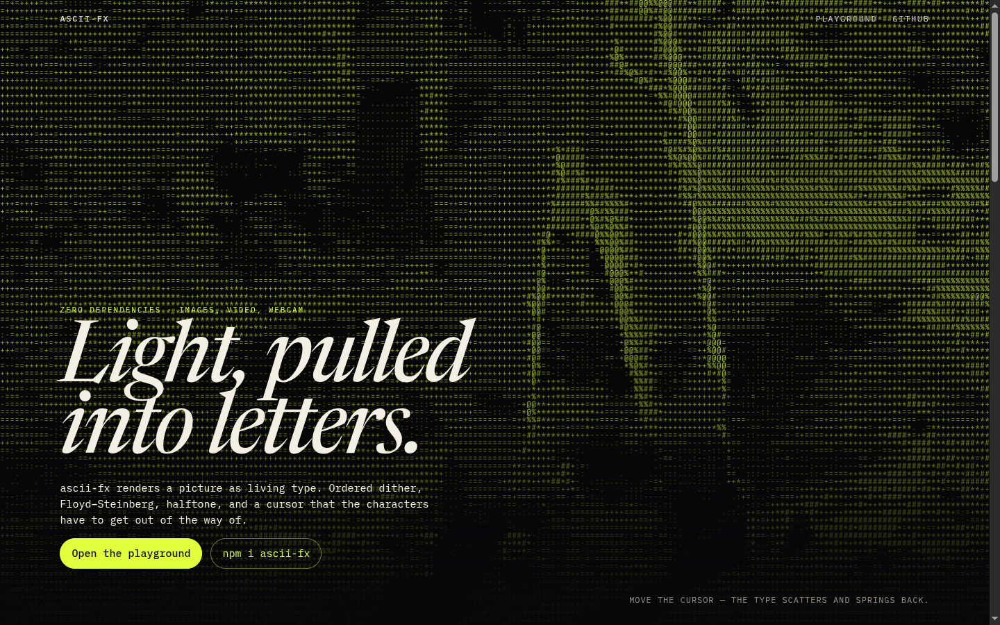

# ascii-fx

Live ASCII, dither, and halftone for an image, a video, or a camera. The core is TypeScript with no runtime dependencies. A `<ascii-fx>` element wraps it for HTML, React, Vue, and Svelte.

[](https://github.com/EmilM32/ascii-fx)

The letters track luminance. Bayer, Floyd–Steinberg, and halftone are separate readings of the same frame. Repel, brighten, and swap follow the pointer with a spring, then fall off with distance.

## Install

```bash
npm i ascii-fx
```

The package is ESM. `ascii-fx` is the renderer. `ascii-fx/element` registers the custom element and is the only entry with a side effect.

Gzipped `dist/index.js`: **14.79 kB**. The custom-element entry (`dist/element.js`) is a few lines that register `<ascii-fx>` and re-export the class.

## JavaScript

```ts
import { createAsciiFx } from 'ascii-fx';

const fx = createAsciiFx(document.querySelector('#stage')!, {
  source: '/cover.jpg', // image, video URL, , <video>, <canvas>, or MediaStream
  charset: 'classic',
  cellSize: 8,
  color: 'duotone',
  foreground: '#e2ff3d',
  background: '#070708',
  dither: 'bayer',
  interaction: 'repel',
  radius: 180,
  strength: 1,
});

fx.update({ dither: 'halftone' });
await fx.toPNG(); // Blob
fx.toText();      // plain ASCII of the current frame
fx.pause();
fx.destroy();
```

`source` URLs ending in `.mp4`, `.webm`, `.ogg`, or `.mov` load as looping, muted video. Remote URLs need CORS, or `toPNG()` and the sampler will fail. Dropped files and `blob:` URLs stay local.

## Custom element

```html
<script type="module">
  import 'ascii-fx/element';
</script>

<ascii-fx
  src="cover.jpg"
  charset="classic"
  cell-size="10"
  color="duotone"
  foreground="#e2ff3d"
  background="#070708"
  dither="bayer"
  interaction="repel"
  radius="180"
  strength="1"
></ascii-fx>
```

Set an object source on the element: `el.source = stream`. `el.toPNG()`, `el.toText()`, `el.play()`, `el.pause()`, and `el.getSnapshot()` match the JS handle. Failures dispatch `ascii-fx-error`. The first frame dispatches `ascii-fx-ready`.

### Attributes

| Attribute | Default | Values |
| --- | --- | --- |
| `src` | — | Image or video URL |
| `charset` | `classic` | `classic`, `standard`, `blocks`, `shades`, `minimal`, `binary`, `braille`, or a custom ramp (darkest first) |
| `cell-size` | `8` | Cell height in CSS pixels, 2–64 |
| `color` | `mono` | `mono`, `color` (alias `original`), `duotone` (alias `tint`) |
| `foreground` | `#f4f1ea` | Ink. Any CSS color |
| `background` | `#090909` | Paper |
| `dither` | `none` | `none`, `bayer` (alias `ordered`), `floyd-steinberg` (alias `floyd`), `halftone` |
| `contrast` | `1` | 0–3 |
| `brightness` | `0` | -1–1, applied after contrast |
| `invert` | off | Boolean attribute |
| `interaction` | `none` | `none`, `repel` (alias `scatter`), `brighten`, `swap` |
| `radius` | `140` | Pointer radius in CSS pixels |
| `strength` | `1` | 0–3 |
| `fps` | `60` | Frame cap. `0` is uncapped |
| `fit` | `cover` | `cover`, `contain` |
| `font` | system monospace | CSS font stack used for the glyph atlas |
| `webcam` | off | Opens the camera and ignores `src` until removed |
| `paused` | off | Boolean attribute |

`braille` samples a 2×4 dot per cell and draws the matching pattern (U+2800–U+28FF in `toText()`). Floyd–Steinberg is for still images. Video and camera streams use Bayer while that mode is selected, so the diffusion doesn’t crawl. `toText()` in halftone mode exports the glyph reading, not dots. `toPNG()` exports the pixels on screen.

`prefers-reduced-motion: reduce` disables pointer effects and holds video on a still frame unless you pass `reducedMotion: 'allow'`. Offscreen elements pause via `IntersectionObserver`. The backing store is capped around 1440×900 and follows device pixel ratio up to 2.

## Options

`createAsciiFx(target, options)` accepts the same fields in camelCase (`cellSize`, `fontFamily`, `reducedMotion`) plus:

| Field | Meaning |
| --- | --- |
| `source` | `'url'`, `HTMLImageElement`, `HTMLVideoElement`, `HTMLCanvasElement`, or `MediaStream` |
| `onError` | `(error: Error) => void` |
| `onReady` | First frame |

`target` is a canvas or any element. A canvas you pass in is used as-is; any other element gets a canvas inside it. The handle:

| Method | |
| --- | --- |
| `update(partial)` | Merge options. A new `source` reloads. |
| `play()` / `pause()` | The draw loop and owned video |
| `destroy()` | Observers, video element, WebGL context |
| `toPNG()` | `Promise<Blob>` |
| `toText()` | Glyphs of the current frame, one row per line |
| `getSnapshot()` | Columns, rows, renderer (`webgl2` or `canvas2d`), fps, effective dither |
| `canvas` | The drawing surface |

Glyphs are instanced in WebGL2 (one quad per cell, atlas sampled at the cell’s pixel size). Halftone is a fullscreen shader: one ink for mono and duotone, RGB screens at 15° / 75° / 0° for original color. If WebGL2 is missing, glyphs fall back to Canvas2D.

Charset presets live on `CHARSET_PRESETS`. `luminance`, `adjustLuma`, `quantizeLuma`, `bayerThreshold`, `floydSteinberg`, and `halftoneDot` are exported for the same math the renderer uses.

## Frameworks

Register the element once. The tag is a normal DOM element after that.

### React

```tsx
import 'ascii-fx/element';

export function Cover() {
  return (
    <ascii-fx
      src="/cover.jpg"
      charset="classic"
      cell-size="8"
      color="duotone"
      foreground="#e2ff3d"
      background="#070708"
      interaction="repel"
    />
  );
}
```

For TypeScript, extend JSX:

```ts
import type { AsciiFxElement } from 'ascii-fx';

declare module 'react' {
  namespace JSX {
    interface IntrinsicElements {
      'ascii-fx': React.DetailedHTMLProps<React.HTMLAttributes<AsciiFxElement>, AsciiFxElement> & {
        src?: string;
        charset?: string;
        'cell-size'?: number | string;
        color?: string;
        dither?: string;
        interaction?: string;
        foreground?: string;
        background?: string;
      };
    }
  }
}
```

### Vue

```ts
// main.ts
import 'ascii-fx/element';
```

```vue
<ascii-fx src="/cover.jpg" charset="blocks" cell-size="10" interaction="brighten" />
```

### Svelte

```svelte
<script lang="ts">
  import 'ascii-fx/element';
</script>

<ascii-fx src="/cover.jpg" charset="classic" cell-size="8" interaction="repel"></ascii-fx>
```

If the template type-checker complains, declare the tag:

```ts
declare namespace svelteHTML {
  interface IntrinsicElements {
    'ascii-fx': {
      src?: string;
      charset?: string;
      'cell-size'?: string | number;
      color?: string;
      dither?: string;
      interaction?: string;
    };
  }
}
```

## Demo

```bash
npm install
npm run dev
```

`npm run build` writes the library to `dist/` and the static site to `site/`. The landing page is a full-viewport `<ascii-fx>` plus a playground: drag-and-drop or a file input (processed locally), webcam, live controls, a snippet that follows those controls, and PNG / TXT export.

Bundled pictures are NASA public-domain Apollo photographs. See `demo/public/samples/ATTRIBUTION.txt`. `scripts/make-samples.sh` rebuilds them.

## Scripts

| Script | |
| --- | --- |
| `npm test` | Glyph mapping, Bayer, Floyd–Steinberg, halftone dots, braille masks |
| `npm run typecheck` | `tsc --noEmit` |
| `npm run lint` | ESLint |
| `npm run build` | Library (ESM + `.d.ts`) and demo |

## License

[MIT](LICENSE) © Emil Majer
